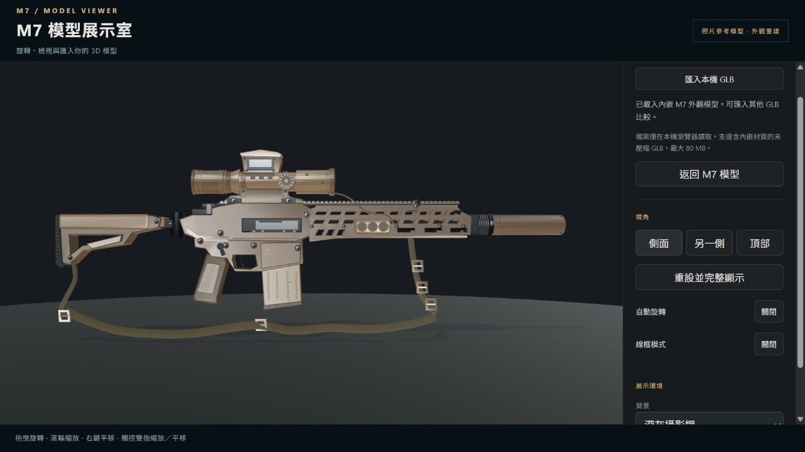

# 由gpt6 Astra製作的M7戰鬥步槍模型

[開啟互動式 3D 展示](https://yogaliu0818.github.io/m7-battle-rifle-gpt6-astra/)

以照片為參考，在 Blender 重建的 M7 外觀模型，使用 Three.js 顯示。

- 滑鼠拖曳旋轉、滾輪縮放、右鍵平移。
- 提供側面、另一側、頂視圖、線框、曝光與背景切換。
- 支援本機未壓縮 GLB 匯入，檔案只在瀏覽器讀取。
- 模型內嵌於 index.html；Three.js 由 jsDelivr CDN 載入，需要網路。
- 模型約 21.5 萬個三角面；照片未顯示的部位採近似補齊，不是精確實物復刻。

## 本機使用

下載 index.html 後用支援 WebGL 的現代瀏覽器開啟。

## 發布

GitHub Pages 從 main 分支根目錄發布；修改 index.html 後推送即可更新。
